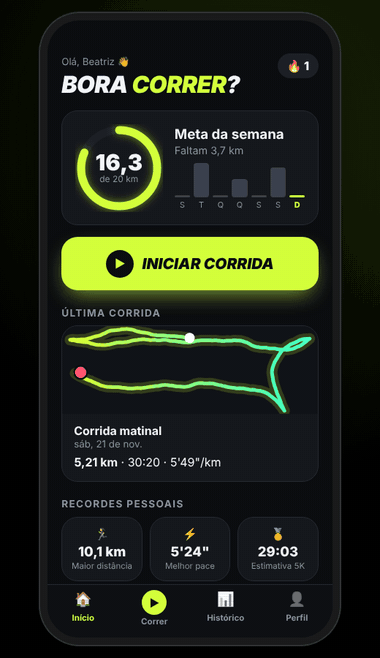

# 🏃‍♀️ Ritmo: App de Corrida

App mobile para corredores, **inspirado em apps como Strava e Nike Run Club**. Registra a corrida ao vivo com mapa do percurso, pace e parciais por km, guarda o histórico e acompanha metas e recordes pessoais.

<p align="center"></p>

🔗 **Demo online:** https://SEU-LINK.vercel.app ← _troque depois do deploy_

---

## ✨ Funcionalidades

- **Corrida ao vivo** com contagem regressiva, mapa do trajeto sendo desenhado, distância, tempo, **pace atual** (últimos 200 m), pace médio e calorias
- **Dois modos de GPS**:
  - **Demonstração**: um GPS simulado percorre um trajeto no ritmo escolhido, e dá para acelerar o tempo (1x, 10x, 30x) para apresentar
  - **GPS real**: usa a localização do celular (`navigator.geolocation`), ignora leituras imprecisas e calcula a distância com a **fórmula de Haversine**
- Pausar, continuar, finalizar ou descartar
- **Resumo da corrida** com mapa, estatísticas e **parciais por km** (com destaque para a melhor)
- **Meta semanal** com anel de progresso e gráfico de km por dia
- **Sequência de dias** correndo 🔥 e **recordes pessoais** (maior distância, melhor pace, estimativa de 5K)
- **Histórico** com miniatura de cada percurso e totais
- **Calculadora de pace**: tempo alvo para 5K, 10K, 21K ou 42K e previsão para outras distâncias (fórmula de Riegel)
- Perfil com peso (para as calorias), meta e ritmo da simulação · dados salvos no navegador

## 🧮 Cálculos (`src/utils/run.js`)

| Cálculo | Fórmula |
|---|---|
| Distância entre coordenadas | Haversine: `2R · asin(√(sin²(Δφ/2) + cos φ1 · cos φ2 · sin²(Δλ/2)))` |
| Pace | `segundos ÷ km` → formato `5'32"` |
| Parciais | interpola o instante exato em que cada km foi completado |
| Calorias | `1,036 × peso (kg) × distância (km)` |
| Previsão de prova | Riegel: `T2 = T1 × (D2 / D1)^1,06` |
| Semana | km por dia, de segunda a domingo |

**12 testes automatizados** cobrem esses cálculos e o simulador de GPS.

## 🛠️ Tecnologias

- **React 19** (hooks, `useRef` para o estado da corrida em tempo real, `setInterval`)
- **Geolocation API** · **SVG** (mapa do percurso, anel de meta)
- **Vite 7** · **CSS3** · **localStorage**
- **Node test runner**

## 📂 Estrutura

```
ritmo-corrida/
├── src/
│   ├── components/
│   │   ├── LiveRun.jsx    # Corrida ao vivo (simulador + GPS real)
│   │   └── RouteMap.jsx   # Desenho do percurso em SVG
│   ├── data/seed.js       # Corridas de exemplo (geradas com semente fixa)
│   ├── utils/run.js       # Cálculos de corrida
│   ├── utils/run.test.js  # Testes
│   ├── App.jsx            # Início, histórico, perfil e resumo
│   └── styles.css
└── docs/demo.gif
```

## 🚀 Como rodar

```bash
git clone https://github.com/beatrizaandradee/ritmo-corrida.git
cd ritmo-corrida
npm install
npm run dev     # http://localhost:5173
npm test        # 12 testes
npm run build
```

> Para testar o **GPS real**, abra no celular pelo link publicado (HTTPS), ative "Usar GPS real" no Perfil e permita a localização.

---

Desenvolvido por **Beatriz Almeida Andrade**, estudante de Engenharia de Software na PUC Minas · [LinkedIn](https://www.linkedin.com/in/beatriz-almeida-975408325/) · [GitHub](https://github.com/beatrizaandradee)
